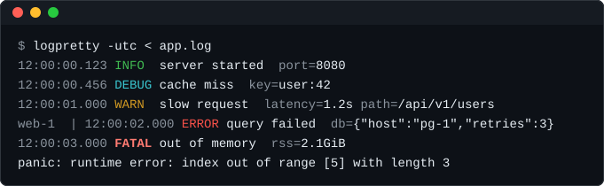

<p align="center">
  
</p>

<h1 align="center">logpretty</h1>

<p align="center">
  Pretty-print JSON, logfmt and plain-text logs from stdin, with level, field and
  expression filters. Built for <code>kubectl logs -f</code>, <code>docker</code> and <code>tail -f</code>.
</p>

<p align="center">
  <a href="https://github.com/ai-fn/logpretty/actions/workflows/ci.yml"></a>
  
  
  
</p>

---

`logpretty` reads a log stream from stdin and prints it in a readable form. It detects the
format of **every line** on its own (JSON, then logfmt, then plain text), so mixed streams
from `kubectl` and `docker compose` work without flags. Output is streamed: it is flushed
whenever the next read would block, so `kubectl logs -f` shows lines as they arrive.

```bash
kubectl logs -f pod | logpretty --level warn --where 'user_id=42' --fields msg,latency
```

> [!NOTE]
> **Status: early development.** Format detection and readable, colored, terminal-safe output
> work. The filters (`--level`, `--where`, `--fields`) are not implemented yet, so the command
> above is the target usage, not something you can run today.

<p align="center">
  
</p>

## Features

| Feature | Status |
|---|---|
| Stream stdin to stdout line by line, any line length (longer lines are cut and marked with what was dropped, as in `…[+2.1MiB]`, and the stream keeps flowing) | Available |
| `--max-line N`: longest line to keep, in bytes (default 1 MiB) | Available |
| Exit codes: `0` success, `1` read/write error, `2` invalid arguments, `130`/`143` on SIGINT/SIGTERM | Available |
| Graceful stop: on SIGINT or SIGTERM the complete lines already read are written out before exit | Available |
| Quiet exit when the reader of stdout leaves early, as in `logpretty \| head` | Available |
| Per-line format detection: JSON, logfmt, plain text; JSON after the prefix of `kubectl logs --timestamps` or `docker compose logs` | Available |
| Readable output: `time LEVEL message  key=value …`, fields in their original order, nested objects as compact JSON | Available |
| Times in the local zone, or in UTC with `--utc` | Available |
| Safe output: control characters from logs never reach the terminal raw | Available |
| Colors: `--color=auto\|always\|never`; `auto` colors only a terminal and respects [`NO_COLOR`](https://no-color.org) and `TERM=dumb` | Available |
| Filters: `--level`, `--where 'key OP value'`, `--fields a,b` | Not yet |

## Installation

```bash
go install github.com/ai-fn/logpretty/cmd/logpretty@latest
```

Or build from source:

```bash
git clone https://github.com/ai-fn/logpretty.git
cd logpretty
make build          # produces bin/logpretty
```

## Usage

Pipe any log stream into `logpretty`. Each line is rendered by its own format, and a line that is
not structured is printed as it is, apart from control characters:

```console
$ cat app.log
{"time":"2026-10-11T12:00:00.123Z","level":"info","msg":"server started","port":8080}
time=2026-10-11T12:00:01Z level=warn msg="slow request" latency=1.2s path=/api/v1/users
web-1  | {"time":"2026-10-11T12:00:02Z","level":"error","msg":"query failed","db":{"host":"pg-1","retries":3}}
panic: runtime error: index out of range
$ logpretty --utc < app.log
12:00:00.123 INFO  server started  port=8080
12:00:01.000 WARN  slow request  latency=1.2s path=/api/v1/users
web-1  | 12:00:02.000 ERROR query failed  db={"host":"pg-1","retries":3}
panic: runtime error: index out of range
```

Control characters are written out, so a log line cannot change the terminal, and a line longer
than `--max-line` is cut with a note of how much was dropped:

```console
$ printf '{"msg":"\\u001b]0;pwned\\u0007"}\n' | logpretty
\x1b]0;pwned\x07
$ printf '0123456789\n' | logpretty --max-line 4
0123…[+6B]
```

On a terminal the output is colored: the time, the keys and a collector's prefix are faint, and
each level has its own style. Into a pipe or a file it is plain, unless `--color=always` asks for
colors, for example for `less -R`:

```bash
kubectl logs -f pod | logpretty --color=always | less -R
```

| Flag | Description |
|---|---|
| `--color WHEN` | When to color the output: `auto` (on a terminal, the default), `always` or `never`. `always` also beats `NO_COLOR` |
| `--utc` | Show times in UTC instead of the local time zone |
| `--max-line N` | Longest line to keep, in bytes (default 1 MiB) |
| `--version` | Print the version |
| `-h`, `--help` | Print the help with examples |

A flag may also be written with one dash, as in `-utc`.

Git Bash and other terminals on Windows that give a program a pipe instead of a console get no
colors in the `auto` mode; use `--color=always` there.

## Development

Requires Go 1.26+, [golangci-lint](https://golangci-lint.run) v2 and `make`. CI runs the tests
on Linux, macOS and Windows, golangci-lint, `go mod tidy` and [govulncheck](https://go.dev/doc/security/vuln/)
on every pull request and every push to `main`.

| Command | Description |
|---|---|
| `make build` | Build `bin/logpretty` |
| `make test` | Run tests with the race detector and coverage, then without it |
| `make lint` | Run golangci-lint (includes gofumpt formatting) |
| `make check` | `test` + `lint`: run this before opening a pull request |
| `make vuln` | Check dependencies and the standard library for known vulnerabilities |
| `make fuzz FUZZ=FuzzName PKG=./path` | Fuzz one target |
| `make bench` | Run benchmarks |
| `make help` | List all targets |

## Project structure

```
cmd/logpretty/        # main() maps signals to a context and calls app.Run
internal/app/         # the pipeline: read, parse, render, write
internal/cli/         # reads the command line into a config; the text of --help
internal/linereader/  # reads lines of any length and truncates at a limit
internal/entry/       # parsed form of a log line: fields, level
internal/parse/       # tells JSON, logfmt and plain lines apart, finds time, level and message
internal/render/      # formats an entry as a line of text and keeps control characters out of the terminal
internal/term/        # decides whether to color the output: the --color mode, the terminal, NO_COLOR
internal/golden/      # test helper: compares output with golden files
testdata/script/      # end-to-end scenarios run against the real binary (testscript)
assets/               # logo, picture of the output
.github/workflows/    # CI
Makefile              # build, test, lint, fuzz, bench, vuln
.golangci.yml         # golangci-lint v2 config
```

## Contributing

Bug reports and pull requests are welcome. Run `make check` before opening a pull request.

## License

MIT, see [`LICENSE`](LICENSE) for the full text.
